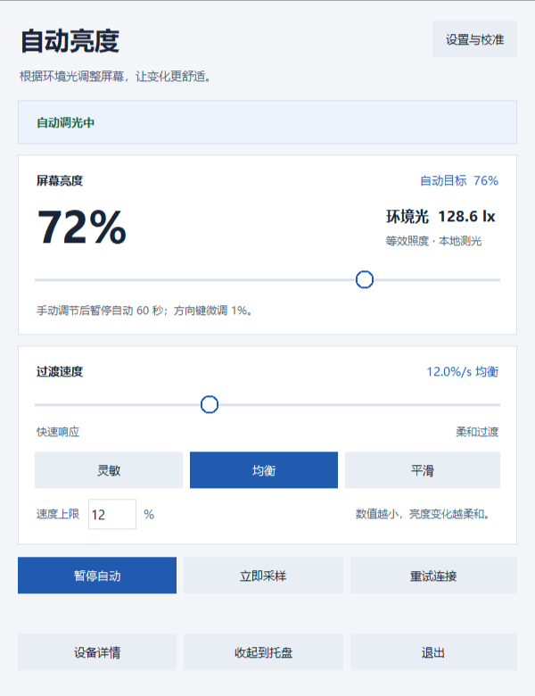

# Camera Auto Brightness · 摄像头自动亮度

用摄像头感知环境光，平滑地调整 Windows 屏幕亮度。
Use a webcam to estimate ambient light and smoothly adjust Windows display brightness.

文档为中英双语；应用界面和多数命令行提示目前使用中文。
Documentation is bilingual; the app UI and most CLI messages currently use Chinese.

## 快速开始 / Quick start

Windows 10/11，64 位；需要可用摄像头及支持软件调光的显示器。
Requires 64-bit Windows 10/11, a working webcam and a display supporting software brightness control.

便携版：从 [Releases](https://github.com/kindlysame55-tech/camera-auto-brightness/releases/latest) 下载 Windows ZIP，解压，双击 `start-camab.exe`。请将其与 `CamabTray.exe` 保持在同一文件夹。
Portable version: download the Windows ZIP from [Releases](https://github.com/kindlysame55-tech/camera-auto-brightness/releases/latest), extract it, and double-click `start-camab.exe`. Keep it beside `CamabTray.exe`.



*界面示例使用模拟状态。Screenshot shows illustrative diagnostic data.*

## 从源码运行 / Run from source

在 PowerShell 执行 / Run in PowerShell:

```powershell
git clone https://github.com/kindlysame55-tech/camera-auto-brightness.git
cd camera-auto-brightness
py -3.12 -m venv .venv
.\.venv\Scripts\python.exe -m pip install -r packaging\requirements.txt
.\.venv\Scripts\python.exe -c "import pathlib,sysconfig; pathlib.Path(sysconfig.get_paths()['purelib'], '_camab_src.pth').write_text(str(pathlib.Path('src').resolve()), encoding='utf-8')"
.\.venv\Scripts\python.exe -m camab tray
```

依赖文件使用阿里云镜像。关闭窗口通常收起到托盘，彻底退出请使用托盘菜单。
The dependency file uses the Aliyun PyPI mirror. Closing the window normally minimizes to the tray; use its menu to quit.

## 原理与功能 / How it works and features

| 中文 | English |
| --- | --- |
| 摄像头采样 → 亮度统计与曝光补偿 → 平滑和校准曲线 → WMI/DDC/CI 调光 → 回读校验 | Camera sampling → luminance statistics and exposure compensation → smoothing and calibration → WMI/DDC/CI control → readback verification. |
| 自动调光每步最多 2 个百分点，写入间隔至少 0.5 秒，遵守更慢的配置限制 | Automatic transitions use steps of at most two percentage points, at least 0.5 seconds apart, respecting slower configured limits. |
| 手动滑块立即调光，默认接管 60 秒后恢复自动，可在设置中更改 | Manual changes apply immediately; the configurable default override lasts 60 seconds. |
| 内屏使用 WMI；兼容外接屏使用 DDC/CI，需要开启显示器的 DDC/CI 设置 | WMI controls internal displays; compatible external monitors use DDC/CI, which must be enabled in the monitor menu. |
| 支持暂停、托盘常驻、小窗口滚动、字体缩放、校准和模拟调光 | Includes pause, system tray, scrollable layouts, text scaling, calibration and dry-run mode. |
| 摄像头估算照度受自动曝光和屏幕反光影响，不等同于专业照度计 | Estimated illumination depends on auto-exposure and screen reflections; it is not a calibrated lux-meter reading. |
| 图像在本机处理，正常运行不保存或上传摄像头图像；指定网络视频源时会连接该源 | Images are processed locally and not saved or uploaded during normal operation; selecting a network source connects to it. |

## 诊断与开发 / Diagnostics and development

以下命令的全局参数放在子命令前。模拟调光与界面自检不写入真实亮度。
Global options precede the subcommand. Dry-run and UI self-test do not write real brightness.

```powershell
.\.venv\Scripts\python.exe -m camab preflight
.\.venv\Scripts\python.exe -m camab devices
.\.venv\Scripts\python.exe -m camab probe --seconds 20
.\.venv\Scripts\python.exe -m camab --dry-run tray
.\.venv\Scripts\python.exe -m pip install pytest
.\.venv\Scripts\python.exe -m pytest -q
powershell -ExecutionPolicy Bypass -File packaging\build_exe.ps1
powershell -ExecutionPolicy Bypass -File packaging\build-launcher.ps1
```

| 现象 / Symptom | 检查 / Check |
| --- | --- |
| 滑块和自动均无效 / Neither manual nor automatic control works | 关闭“仅模拟调光”，查看界面错误，运行 `preflight`，确认显示器支持调光。 / Disable dry-run, inspect the error, run `preflight`, and check display support. |
| 手动有效，自动无效 / Manual works, automatic does not | 检查暂停、手动接管倒计时、摄像头输入和校准曲线。 / Check pause, override countdown, camera input and calibration. |
| 摄像头黑屏 / Black camera input | 先测试 Windows 相机，再检查隐私权限、设备序号与占用程序。 / Test in Windows Camera, then check permissions, device index and competing apps. |
| 外接屏无响应 / External display does not respond | 开启 DDC/CI；转接器和扩展坞可能限制兼容性。 / Enable DDC/CI; adapters and docks may limit compatibility. |

配置与日志位于 `%LOCALAPPDATA%\camera-auto-brightness\`，不入库。测试隔离用户配置并使用模拟后端；实际硬件兼容性需另行验证。
Configuration and logs live in `%LOCALAPPDATA%\camera-auto-brightness\`, outside Git. Tests isolate user configuration and use fake backends; hardware compatibility needs separate verification.

## 许可 / License

目前未指定开源许可证。公开可见不代表已授予开源使用或再分发许可。
No open-source license has been specified. Public visibility alone does not grant an open-source license to use or redistribute this project.

<details>
<summary>历史中文开发记录（部分内容和本地输出链接已过时） / Historical Chinese development notes (some details and local links are outdated)</summary>

## 一句话目标

用**摄像头当环境光传感器**，实时估计房间亮度并自动调节 Windows 屏幕亮度；
在没有光线传感器的台式机/笔记本上，复刻「自动亮度」体验。

## 为什么可行 / 难点

| 项 | 说明 |
| --- | --- |
| 原理 | 周期取摄像头帧 → 灰度/线性亮度统计（均值 + 分位数）→ 估计环境照度 → 映射到屏幕亮度百分比 → 调用 Windows 亮度接口 |
| 优势 | 不依赖 ALS 光线传感器；对「开灯/拉窗帘/换房间」响应直观 |
| 难点 1 | 摄像头有自动曝光（AGC），会自己把画面调亮 → 必须用曝光/增益补偿校正，否则环境变暗时画面不变 |
| 难点 2 | 摄像头若照到屏幕本身 → 屏幕调亮 → 画面变亮 → 再调亮 = 正反馈振荡 → 需要滞回 + 冷却 + 变化率限制 + 区域屏蔽 |
| 难点 3 | 笔记本内屏走 WMI，外接显示器要走 DDC/CI，两者 API 完全不同 → 抽象成多后端 |

## 验收标准（Definition of Done）

1. `preflight` 自检能给出结论：摄像头是否可取帧、哪块屏可写亮度、可用后端是什么。
2. 引擎在**自动模式**下：调暗环境 / 用光照射（保持有效画面）→ 屏幕亮度在 30 秒内跟随变化，且方向正确；无源或完全黑画面保持当前亮度。
3. 稳定光照下**无可见抖动**：亮度调整频率受限（冷却 ≥ N 秒），无来回摇摆超过 2 次。
4. 支持 手动覆盖（托盘调亮度后暂停自动 X 分钟）、暂停/恢复、干跑模式（不改亮度只记录）。
5. 全部核心逻辑有单元测试（映射曲线、平滑、迟滞、亮度统计），`pytest` 全绿。
6. 配置持久化到 JSON；有中文使用说明与一键启动脚本。
7. Git 分阶段存档：每个里程碑一个 tag + `archive/v0.4/` 这样的全量快照。

## 目录结构

```
camera-auto-brightness/
├── README.md            本文件：目标 + 验收标准
├── STATUS.md            当前状态 / 下一步 / 阻塞
├── src/camab/           源码包
│   ├── preflight.py     环境自检（摄像头 + 亮度后端）
│   ├── camera.py        摄像头采集（低分辨率、失败重试、曝光信息）
│   ├── lightmeter.py    环境光估计（线性空间统计 + 曝光补偿 + 等效 lux）
│   ├── mapping.py       照度→亮度映射曲线（含滞回、步进限速、冷却）
│   ├── brightness/      亮度后端：wmi / ddc / dryrun
│   ├── engine.py        主循环（自动/手动/暂停 + 反馈自激抑制）
│   ├── config.py        配置读写
│   ├── tray.py          托盘 GUI + 设置面板
│   └── __main__.py      CLI 入口
├── tests/               单元测试
├── scripts/             存档脚本、启动脚本
├── notes/               设计笔记、调研
├── archive/             【自动生成】每个里程碑的全量快照
├── packaging/           PyInstaller 打包脚本
└── tmp/                 临时文件（不入库）
```

## 用法

### 2026-10-11 界面与运行层重构

- 主窗口集中显示当前亮度、自动目标、手动接管倒计时与设备状态；硬件连接、亮度写入、恢复和校准在后台进行。
- 「设置与校准」分为日常调节、自动校准、高级参数。采样速度立即应用；其他输入通过全部校验、保存成功后才应用。
- 配置与运行引擎使用独立快照；测光分位、避反光和屏幕反光系数可实时更新。退出校准会先恢复原亮度，再恢复原来的自动/暂停状态。
- 摄像头帧使用序号与条件等待，掉线时不再复用旧画面；托盘只在亮度或暂停状态变化时重绘。日志滚动保存（2 MB × 当前文件及 3 份备份）。
- 「仅模拟调光」包括手动滑块，均不写入真实屏幕。托盘不可用时，关闭主窗口会正常退出。
- 小窗口可滚动，滑块支持方向键，设置的保存按钮始终保留在窗口底部。

审查报告与示例界面：[2026-10-11-camab-review.md](../../30-output/reports/2026-10-11-camab-review.md)。

开发验证（测试配置和日志均隔离，常规测试使用假亮度后端）：

```powershell
.\.venv\Scripts\python.exe -m pytest -q
.\.venv\Scripts\python.exe -m camab --dry-run tray --selftest
```

`tray --selftest` 现在仅检查界面，不打开摄像头、不连接亮度后端。设备连通性另用 `preflight` 或 `devices` 检查。

给不熟悉命令行的用户：**双击项目根目录的 `start-camab.exe`**，直接打开新版界面，全程不出现命令窗口。

2026-10-11 回归修复版已恢复真实内屏调光：修正 EXE 继承低完整性级别造成的 WMI 拒绝访问，恢复物理摄像头的兼容采集路径。界面会持续显示调光失败原因；无有效画面时保持亮度。原有配置保留，手动调节成功后按原设置暂时接管自动调光。

2026-10-13 重绘版采用浅色界面，主窗口、设置各页和校准支持小窗口滚动及放大字体。自动亮度分成最多 2 个百分点的小步柔和过渡，手动调节仍立即生效；速度输入表示上限。内屏优先使用命名 WMI 参数直接写入并等待真实回读，失败才使用 CIM 回退。原有曲线和用户配置保留。详见[本轮验证记录](../../30-output/reports/2026-10-13-camab-redraw.md)。
启动器为子程序选择可写的临时目录，保留原配置，重复点击会打开已运行的程序或提示查看托盘。
完整便携文件夹位于 `../../30-output/apps/camera-auto-brightness/`；移动时保留其中的 `start-camab.exe` 和 `CamabTray.exe`。
启动器可用 `powershell -ExecutionPolicy Bypass -File packaging\build-launcher.ps1` 重新构建。
原有 `scripts\start-silent.vbs` 仍可使用；想要桌面图标先跑一次 `scripts\make_shortcut.ps1`。
`scripts\start.cmd` 是**命令行诊断入口**，带参数运行：`check` 环境自检、`devices` 摄像头设备诊断、
`probe` 只测光 30 秒、`run` 前台运行、`dry` 干跑、`tray` 托盘版、`help` 速查
（双击它会先弹一个黑框，**不适合日常常驻**）。
打包产物名已确定：`dist\CamabTray.exe`（托盘版）、`dist\Camab.exe`（命令行版，参数与下文一致）；
若 `dist\` 为空（例如正在重新打包），`scripts\start-silent.vbs` 会自动退回 `.venv` 源码方式启动。

以下命令都在项目根目录执行（`.venv` 内已有指向 `src` 的 `.pth`，可直接 `-m camab`）：

```powershell
# -1) 启动器与快捷方式
.\start-camab.exe                             # 日常双击此 EXE，打开界面
scripts\start-silent.vbs                       # 原有 VBS 启动入口
powershell -ExecutionPolicy Bypass -File scripts\make_shortcut.ps1   # 建桌面快捷方式
scripts\camab.cmd devices                      # 通用命令行包装（优先用 dist\Camab.exe）

# 0) 环境自检：依赖 + 摄像头取帧 + 亮度后端（退出码 0=就绪/1=有阻塞项）
.\.venv\Scripts\python.exe -m camab preflight

# 摄像头设备诊断（排查「能开但全黑」「幽灵设备/Code 45」）
.\.venv\Scripts\python.exe -m camab devices

# 1) 前台运行（可见日志，Ctrl+C 停止）
.\.venv\Scripts\python.exe -m camab run

# 2) 托盘常驻（右下角图标；关窗口只是收起，右键菜单退出）
.\.venv\Scripts\python.exe -m camab tray

# 3) 干跑：只记录不真的改亮度
.\.venv\Scripts\python.exe -m camab --dry-run run

# 4) 只测光 20 秒（验证摄像头对光是否敏感，不改亮度）
.\.venv\Scripts\python.exe -m camab probe --seconds 20

# 5) 用别的视频源（本机摄像头出不了画面时的绕过方案）
#    注意：--source / --index / --dry-run 是全局参数，必须写在子命令之前
.\.venv\Scripts\python.exe -m camab --source "D:\videos\room.mp4" run
.\.venv\Scripts\python.exe -m camab --source "http://192.168.1.5:8080/video" tray   # 手机 IP Webcam
.\.venv\Scripts\python.exe -m camab --index 1 run                                  # 换摄像头序号

# 6) 指定亮度后端（auto 优先 WMI 内屏；外接屏走 ddc）
.\.venv\Scripts\python.exe -m camab run --backend ddc

# 7) 手感与标定（用户反馈「不灵敏/不线性/太灵敏」的三件套）
.\.venv\Scripts\python.exe -m camab preset                     # 列出现有预设与当前值
.\.venv\Scripts\python.exe -m camab preset sensitive           # 1.5s/3%/2.5s/20%/EMA0.6
.\.venv\Scripts\python.exe -m camab preset calm                # 4.0s/7%/8.0s/10%/EMA0.3
.\.venv\Scripts\python.exe -m camab preset balanced            # 默认：2.5s/4%/4.0s/16%/EMA0.45
.\.venv\Scripts\python.exe -m camab calibrate-screen --yes     # 标定屏幕反光（约 15s，自动恢复亮度）
.\.venv\Scripts\python.exe scripts\sweep_percentile.py --frames 8   # 扫测光分位，挑一个更合适的
.\.venv\Scripts\python.exe scripts\compare_defaults.py         # 对比你的配置 vs 出厂默认的目标亮度

# 8) 配置（单个数字可以 config set；曲线折点 anchors 只能编辑 config.json）
.\.venv\Scripts\python.exe -m camab config show
.\.venv\Scripts\python.exe -m camab config set analysis.percentile 20
.\.venv\Scripts\python.exe -m camab config reset
# 注意：camab calibrate 改的是旧参数 lux_dark/lux_bright，当前曲线由 anchors 决定 → 已不影响亮度

# 9) 端到端跟随验证（合成光序列直接驱动引擎，不依赖摄像头/视频）
#    默认干跑（有状态模拟屏幕，不动真实亮度）；--real 才真改亮度且跑完自动恢复
.\.venv\Scripts\python.exe scripts\verify_tracking.py
.\.venv\Scripts\python.exe scripts\verify_tracking.py --real
.\.venv\Scripts\python.exe scripts\verify_tracking.py --seconds 1 --json tmp\tracking.json

# 10) 托盘界面自检 + 截图（渲染几帧就退出，不留在桌面上；写文档/排查用）
.\.venv\Scripts\python.exe -m camab --dry-run tray --selftest --screenshot tmp\tray-window.png

# 11) 其它排查脚本
.\.venv\Scripts\python.exe scripts\list_devices.py --max 6      # OpenCV 层逐个索引试开摄像头
.\.venv\Scripts\python.exe scripts\set_brightness.py            # 只读当前屏幕亮度
.\.venv\Scripts\python.exe scripts\set_brightness.py 30         # 设为 30%（会真的改，记得调回）
.\.venv\Scripts\python.exe scripts\make_test_video.py --out tmp\light-ramp.mp4   # 生成光照变化视频
```

脚本编码硬规矩（改脚本前必读）：`scripts\start-silent.vbs` **必须 GBK/ANSI**
（WSH 按系统代码页读 .vbs，存 UTF-8 会报"未结束的字符串常量 (29,51)"）；
`scripts\start.cmd` **必须 GBK/ANSI + CRLF，且禁用 `goto :标签`**（中文多字节会让 goto 跳错行）；
`packaging\*.ps1` 用 **UTF-8 with BOM**。

配置文件：`%LOCALAPPDATA%\camera-auto-brightness\config.json`（未保存过设置时不存在，用内置默认值）；
日志：同目录下 `camab.log`。

📖 完整中文使用说明书（面向不懂编程的用户，含界面截图、设置面板逐项说明、折点曲线怎么改、
「如果觉得不灵敏/不线性/太灵敏」的调整路径、三步自检与常见问题）：
[`../../30-output/docs/2026-10-07-摄像头自动亮度-使用说明.md`](../../30-output/docs/2026-10-07-摄像头自动亮度-使用说明.md)

## 存档约定

每完成一个里程碑运行一次：

```powershell
.\.venv\Scripts\python.exe scripts\archive.py --milestone v0.1 --label "亮度后端+映射引擎"
```

它会：① `git add -A` + commit；② 打 tag；③ 把当前全量源码拷进 `archive/v0.4/` 这样的目录，
并在该目录里写入一个 meta 清单（含 commit hash，用 `dir archive\v0.4` 可看到）；
④ 追加 `archive/INDEX.md`。

</details>
